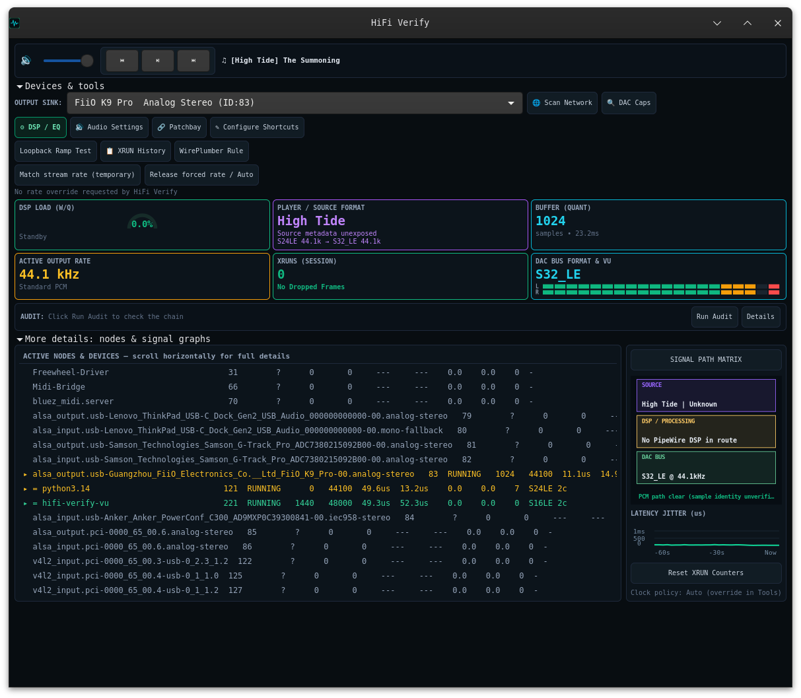

<div align="center">

# 🎧 HiFi Verify

### *A native Rust & GTK4 audio path monitor, PipeWire graph auditor, and ALSA hardware verifier for Linux*

[](https://github.com/richardeaves900-pixel/HiFi-Verify/actions/workflows/rust.yml)
[](LICENSE)
[](https://www.rust-lang.org/)
[](https://gtk-rs.org/)
[](flatpak/org.cachyos.HiFiVerify.yaml)

<br />



</div>

---

## Why HiFi Verify?

On Linux, verifying that your audio stack isn't silently resampling, attenuating, or routing playback through an unwanted DSP filter usually means juggling `pw-top`, `pw-dump`, `qpwgraph`, and `/proc/asound/.../hw_params` in separate terminals.

**HiFi Verify** combines hardware-direct ALSA inspection, live PipeWire graph route tracing, passive stereo metering, desktop tray/panel telemetry, and a scriptable CLI into one lightweight Rust application.

### Honest Verification Model

Many audio utilities declare a stream "bit-perfect" simply because two sample-rate numbers happen to match. HiFi Verify intentionally draws a strict line between **what can be observed** and **what is mathematically proven**:

- **Live Monitoring (`CLEAR` / `ALTERED` / `UNVERIFIED` / `STANDBY`):** Traces the exact active PipeWire link chain from your player to your ALSA DAC, compares the stream's negotiated PCM format/rate/channels against `/proc/asound/card*/pcm*p/sub*/hw_params`, and inspects for in-route DSP or reported player-side gain. Even a clean `CLEAR` reading explicitly states *"sample identity unverified"* because passive monitoring alone cannot inspect upstream decoding or analog DAC output.
- **Deterministic Sample Verification (`--verify-reference` / `--verify-capture` & `--ramp-test`):** When you want mathematical proof across a digital loopback or monitor capture point, HiFi Verify performs strict contiguous sample-for-sample PCM comparison (supporting 16-, 24-, and 32-bit integer WAVs, automatic lead-in alignment, and lossless bit-width expansion such as 16-bit → `S32_LE`).

---

## Complete Feature Set

### 1. Hardware-Direct ALSA Telemetry
- Directly reads `/proc/asound/card*/pcm*p/sub*/hw_params` (filtered strictly to **playback** PCM subdevices, never microphones or capture interfaces).
- Reports the exact active DAC format (e.g., `S32_LE`, `S24_3LE`, `S16_LE`), hardware sample rate, channel count, period size, and buffer size.
- Maps the active PipeWire sink's ALSA card ID (`api.alsa.card`) directly to its matching `/proc/asound/cardN` hardware subdevice so multi-DAC systems are never misattributed.

### 2. Route-Aware PipeWire Graph & Multi-Hop DSP Tracing
- Parses live `pw-dump` graph topology alongside negotiated `pw-top` stream formats (preserving the `FORMAT` column's negotiated sample rate even for follower streams whose graph `RATE` column reads `0`).
- Performs multi-hop link traversal from the running playback stream to the target `alsa_output.*` sink:
  - **Direct route (`Player → ALSA Sink`):** Evaluated for rate, channel, and bit-depth precision consistency.
  - **In-route DSP (`Player → EasyEffects / JamesDSP / Carla / filter-chain → ALSA Sink`):** Explicitly flagged as **`ALTERED`** with the active DSP node(s) named.
  - **Unrelated background DSP:** A DSP app running elsewhere in PipeWire that is *not* linked into the active playback chain is shown as bypassed and will **not** falsely red-flag a clean direct hardware route.
- Identifies applications accurately across Flatpaks, PipeWire clients, MPRIS, and MPD, with dedicated support for local FLAC header parsing and High Tide's raw playbin gain/normalization bridge.

### 3. Real-Time Passive Stereo VU Meter
- Built-in 20-segment Left/Right dBFS meter (`-60` to `0 dBFS`) with independent stereo RMS bars, ballistic peak-hold markers, and digital full-scale clip LEDs.
- Backed by a passive PipeWire sink monitor (`pw-record` with `node.passive=true` and `stream.capture.sink=true`):
  - **Never** wakes an idle DAC or pins the PipeWire hardware sample rate (e.g., your DAC switches freely between `44.1 kHz`, `96 kHz`, and `192 kHz`).
  - Automatically starts only when the window is visible and playback is active, and stops cleanly when hidden to the tray or idle.

### 4. Interactive GTK4 Dashboard & Diagnostics
- **Live Telemetry Cards:**
  - **DSP Load (`W/Q`):** Color-coded gauge showing peak running PipeWire node load (accurately handles `>= 100%` overrun ratios).
  - **Player / Source Format:** Active player identity, source codec/rate/depth (when exposed), and live `Stream PCM → DAC PCM` comparison.
  - **Buffer (`QUANT`):** Active sample quantum and calculated buffer latency in milliseconds.
  - **Active Output Rate:** Live hardware rate with automatic `Standard PCM` vs `Hi-Res PCM` (`>= 88.2 kHz`) classification.
  - **XRUNs (Session):** Session delta since launch (resettable without touching kernel counters) alongside cumulative logging.
  - **DAC Bus Format & VU:** Live ALSA hardware format paired with the real stereo VU meter.
- **Signal Path Matrix & On-Demand Cava Spectrum:** Toggle between the 3-stage Cairo flowchart (`SOURCE → DSP / PROCESSING → DAC BUS`) and an on-demand 32-band `cava` frequency spectrum (started lazily only while toggled visible, Flatpak-safe, and cleanly terminated on hide/exit).
- **60-Second Latency Jitter Scope:** Plots live `pw-top` `WAIT` latency in microseconds across a 60-second rolling window (`-60s / -30s / Now`).
- **Live Node Table:** Scrollable `pw-top` snapshot highlighting running nodes, warnings, and per-node format/rate/XRUN counters.
- **Full Audit Bar & Details Modal:** Runs a complete path audit on demand and opens a full findings + suggested fixes report.
- **Temporary Runtime Rate Override:** Optional one-click `Match stream rate (temporary)` and `Release forced rate / Auto` controls using `pw-metadata -n settings 0 clock.force-rate` (never modifies persistent system configs).
- **Output Sink Switcher, Media Controls & Volume:** Switch default PipeWire sink (`wpctl set-default`), control MPRIS playback (`⏮ ⏯ ⏭`), and adjust sink volume asynchronously without blocking the UI.

### 5. Desktop-Agnostic, User-Configurable Shortcuts
- Launchers for **Music Player** (clicking the Player/Source card), **DSP / EQ**, **Audio Settings**, and **Patchbay** (clicking the DAC card or toolbar button) automatically detect installed desktop tools (`kcmshell6 kcm_pulseaudio`, `gnome-control-center sound`, `pwvucontrol`, `pavucontrol`, `easyeffects`, `jamesdsp`, `qpwgraph`, `helvum`, `carla`, and common Linux music players).
- Customize any launcher via **Devices & tools → ✎ Configure Shortcuts** (saved to `~/.config/hifi-verify/config.json`); leave any field blank to fall back to auto-detection.

### 6. Built-In Hardware, Network & Configuration Utilities
- **DAC Capability Viewer (`🔍 DAC Caps`):** Parses USB Audio `/proc/asound/card*/stream0` **Playback** sections (ignoring Capture/microphone sections), expands continuous sample rate ranges (e.g., `44100 - 384000`), detects Native DSD transport formats, and falls back to active ALSA `hw_params` for PCI/HDA/HDMI DACs.
- **Per-Node XRUN History (`📋 XRUN History` / `--history`):** Automatically logs newly observed per-node XRUN increments to SQLite (`~/.config/hifi-verify/history.db`), resilient against transient `pw-top` timeouts.
- **WirePlumber 0.5 Rule Generator (`WirePlumber Rule` / `--wireplumber`):** Generates valid SPA-JSON `monitor.alsa.rules` (`audio.rate`, `audio.allowed-rates`, `node.latency`, `api.alsa.period-size`) with one-click clipboard copy for `~/.config/wireplumber/wireplumber.conf.d/50-hifi-verify-alsa.conf`.
- **UPnP / SSDP Network Scanner (`🌐 Scan Network` / `--network-scan`):** Discovers local subnet `MediaRenderer` devices via SSDP multicast and resolves their XML `<friendlyName>` alongside IP addresses.
- **Loopback Ramp / Null Test (`Loopback Ramp Test` / `--ramp-test`):** Generates a 16-bit PCM ramp WAV, pairs a PipeWire/PulseAudio `.monitor` source with its sink via `pactl`, captures raw PCM through `parec`, and verifies exact sample integrity via `pcm_verify`.

### 7. System Tray Icon & KDE Plasma 6 Panel Widget
- **HiDPI System Tray (`StatusNotifierItem`):** Procedural 32×32 and 64×64 badge with distinct status glyphs and a cyan Hi-Res pip (`>= 88.2 kHz`), rich hover tooltip, live status title (`HiFi Verify · 96kHz S32_LE [CLEAR]`), scroll-wheel ±5% volume control, MPRIS playback controls, desktop notifications when in-route DSP activates, and Flatpak sandbox compatibility (`disable_dbus_name`).
- **KDE Plasma 6 Toolbar Widget ([plasmoid/org.cachyos.hifiverify](plasmoid/org.cachyos.hifiverify)):** Native Plasma 6 panel pill displaying a color-coded status dot and live rate/format readout (`44.1kHz S32_LE`, `96kHz S32_LE`, `IDLE`), hover tooltip, expandable live telemetry popup, and configurable CLI command/polling interval.

---

## Understanding Status Indicators

The same route-aware assessment drives the GTK4 dashboard, System Tray icon, KDE Plasma 6 widget, and CLI:

| State | Color / Tray Glyph | Meaning |
| :--- | :--- | :--- |
| **`CLEAR`** | 🟢 Emerald Check (+ cyan pip if `>= 88.2 kHz`) | Direct link from playback stream to ALSA DAC, signed integer PCM with matching sample rate & channels and no bit-depth reduction, and no active DSP in route. *(Original upstream sample identity remains unverified without a capture test.)* |
| **`ALTERED`** | 🔴 Ruby `!` | Active modification observed: rate conversion (resampling), channel mismatch, precision reduction, in-route PipeWire DSP (e.g., EasyEffects), or active player-side gain/normalization. |
| **`UNVERIFIED`** | 🟡 Amber `?` | Playback is active, but the direct route, negotiated PCM format, or float-to-integer conversion status could not be conclusively established. |
| **`STANDBY`** | ⚫ Slate Dot | No active playback stream detected. |

---

## Command Line Interface (CLI)

Every diagnostic capability is available headlessly for scripting, Waybar/Polybar/Plasma widgets, or quick terminal checks:

| Flag | Description |
| :--- | :--- |
| `--health` | Compact one-line summary (`App/Codec \| Rate \| Quantum \| warnings`). |
| `--status` | Structured JSON for the KDE Plasma 6 widget and status bars (`state`, `status`, `badge`, `short_label`, `reason`, `app`, `track`, `codec`, `stream_pcm`, `dac_pcm`, `rate_hz`, `quantum`, `route_dsp`, `processing`). |
| `--audit` | Full JSON audit containing `verdict`, `findings`, actionable `fixes`, `hw_params`, stream/DAC PCM details, and DSP status. |
| `--audit --fast` | Skips cumulative XRUN reporting while keeping live `pw-top` PCM route evaluation. |
| `--hw` | Lists open ALSA playback PCM devices (`format`, `rate`, `channels`, `buffer_size`, `/proc` path). |
| `--history` | Prints the last 50 logged per-node XRUN events from `~/.config/hifi-verify/history.db`. |
| `--network-scan` | Scans the local subnet for UPnP / SSDP audio renderers and prints resolved names & IPs. |
| `--verify-reference <WAV> --verify-capture <WAV>` | Strict sample-for-sample PCM comparison between a trusted reference WAV and a captured monitor WAV (exits `0` on `pass`, `1` on `fail`/`inconclusive`, `2` on usage error). |
| `--ramp-test` | Runs the automated 48 kHz loopback ramp test and outputs JSON verification results. |
| `--wireplumber` | Prints a WirePlumber 0.5 SPA-JSON ALSA rule matching the current active output rate and quantum. |
| `--gui` | Launches the GTK4 dashboard and system tray (default when no CLI flag is passed). |

### Example CLI Output

```bash
# Flatpak usage (or simply `hifi-verify ...` for native installs)
flatpak run org.cachyos.HiFiVerify --status
```

```json
{
  "app": "High Tide",
  "badge": "44.1kHz S32_LE",
  "codec": null,
  "dac_pcm": "S32_LE 44.1kHz 2ch",
  "processing": [],
  "quantum": 1024,
  "rate_hz": 44100,
  "reason": "Connected PCM path clear (samples unverified)",
  "route_dsp": [],
  "short_label": "CLEAR",
  "state": "green",
  "status": "clear",
  "stream_pcm": "S24LE 44.1kHz 2ch",
  "track": "The Summoning"
}
```

```bash
flatpak run org.cachyos.HiFiVerify --hw
# HW: S32_LE @ 44100Hz, 2ch, buffer 32768  (/proc/asound/card3/pcm0p/sub0/hw_params)

flatpak run org.cachyos.HiFiVerify --verify-reference original.wav --verify-capture monitor_capture.wav
```

---

## Installation & Building

### Prerequisites (Host Tools)
HiFi Verify queries the standard PipeWire CLI utilities on the host (both natively and via `flatpak-spawn --host` when sandboxed):
- **Core:** `pipewire` (`pw-dump`, `pw-top`, `pw-metadata`, `pw-record`), `wireplumber` (`wpctl`)
- **Optional:** `cava` (32-band audio spectrum), `pulseaudio-utils` / `pipewire-pulse` (`pactl`, `parec`, `paplay` for `--ramp-test`)

### Option 1: Flatpak (Recommended for Desktop)

Requires `flatpak`, `flatpak-builder`, `org.gnome.Platform//49`, `org.gnome.Sdk//49`, and `org.freedesktop.Sdk.Extension.rust-stable//25.08`:

```bash
flatpak-builder --user --force-clean --install \
  --state-dir=flatpak/.flatpak-builder \
  flatpak/build-dir \
  flatpak/org.cachyos.HiFiVerify.yaml
```

Launch the app:

```bash
flatpak run org.cachyos.HiFiVerify
```

### Option 2: Portable USB Edition (Zero-Install / Any Linux PC)

Run HiFi Verify directly off a USB drive (FAT32, exFAT, NTFS, or ext4) without installing anything, or carry a single-file Flatpak bundle for older/immutable distros.

- **Pre-built download:** Grab `HiFi-Verify-Portable-x86_64.tar.gz` (or the standalone `HiFi-Verify-x86_64.flatpak` bundle) from the [GitHub Releases](https://github.com/richardeaves900-pixel/HiFi-Verify/releases) page, extract `HiFi-Verify-USB/` onto your USB stick, and run:
- **Or build your own USB kit from source:**

```bash
bash scripts/build-portable.sh
# Outputs:
#   dist/HiFi-Verify-USB/
#   dist/HiFi-Verify-Portable-x86_64.tar.gz
```

On any target Linux x86_64 PC, open a terminal inside `HiFi-Verify-USB/` on the USB drive:

```bash
# Zero-install portable run (works even on FAT32/exFAT `noexec` USB mounts):
sh run-hifi-verify.sh
sh run-hifi-verify.sh --audit --fast

# Use the host PC's ~/.config instead of the USB's ./data/ folder:
sh run-hifi-verify.sh --system-config

# Universal fallback for older glibc (< 2.39) or systems without GTK4 (Ubuntu 22.04, Debian 12, Silverblue):
sh install-flatpak.sh

# Optional KDE Plasma 6 toolbar widget install from USB:
sh install-plasmoid.sh
```

What `run-hifi-verify.sh` handles automatically:
- **FAT32 / exFAT `noexec` auto-staging:** If the USB drive cannot execute binaries directly, it transparently stages `bin/hifi-verify` into `$XDG_RUNTIME_DIR` (or `/tmp/hifi-verify-portable-<uid>`) and launches from there.
- **Portable USB storage:** Exports `XDG_CONFIG_HOME` to `./data/` on the USB drive so your configured shortcuts (`config.json`) and XRUN history (`history.db`) travel with you.
- **Graceful distro fallback:** Verifies GTK4/glibc compatibility before launch and guides/falls back to the bundled `HiFi-Verify-x86_64.flatpak` when needed.

### Option 3: Native Cargo Build

Requires Rust stable and GTK4 development headers (`libgtk-4-dev` on Debian/Ubuntu, `gtk4` on Arch/CachyOS, `gtk4-devel` on Fedora):

```bash
cargo build --release --locked
./target/release/hifi-verify
```

### KDE Plasma 6 Panel Widget (Plasmoid)

Install the included Plasma 6 toolbar widget locally:

```bash
kpackagetool6 --type Plasma/Applet --install plasmoid/org.cachyos.hifiverify
```

Then right-click your KDE panel → **Add or Manage Widgets** → search **HiFi Verify**. By default it queries `flatpak run org.cachyos.HiFiVerify`; for native installs, right-click the widget → **Configure HiFi Verify** and set the CLI command to `hifi-verify`.

---

## Configuration & Data Files

| Path | Purpose |
| :--- | :--- |
| `~/.config/hifi-verify/config.json` | User-configurable external tool shortcuts (`player_cmd`, `audio_settings_cmd`, `dsp_cmd`, `patchbay_cmd`). |
| `~/.config/hifi-verify/history.db` | SQLite database storing timestamped per-node XRUN events. |
| `~/.config/hifi-verify/ramp-test/` | Reference and capture WAV files generated during `--ramp-test`. |
| `~/.config/wireplumber/wireplumber.conf.d/50-hifi-verify-alsa.conf` | Recommended destination for rules generated by `--wireplumber` / **WirePlumber Rule**. |

---

## Architecture Overview

```text
src/
├── main.rs              # CLI argument parsing, --status JSON, tray + GTK bootstrap
├── model.rs             # Shared domain types (HwParams, PlaybackPcm, PathStatus, format bit parser)
├── host.rs              # Timeout-enforced host_cmd, zombie-free host_popen, Flatpak detection
├── config.rs            # User-configurable desktop-agnostic tool shortcuts (~/.config/hifi-verify/config.json)
├── alsa_proc.rs         # Hardware-direct /proc/asound/card*/pcm*p/sub*/hw_params reader
├── pwtop.rs             # pw-top -b parser (negotiated FORMAT rates, W/Q & B/Q ratios, XRUN totals)
├── telemetry/
│   ├── mod.rs           # App attribution and stream selection
│   ├── pw_graph.rs      # pw-dump graph parser, multi-hop DSP route tracer, path assessment
│   ├── mpris.rs         # Session D-Bus MPRIS metadata, transport controls, High Tide gain bridge
│   ├── mpd.rs           # MPD TCP telemetry and mpd.conf auditor
│   └── proc_sniff.rs    # Local FLAC header parser and /proc fd sniffing
├── audit.rs             # Full audio path audit, findings, and actionable fix generation
├── pcm_verify.rs        # Strict sample-for-sample integer WAV verifier (16/24/32-bit)
├── ramp.rs              # Automated loopback monitor ramp test backed by pcm_verify
├── vu.rs                # Passive stereo PipeWire VU meter (pw-record node.passive=true)
├── cava.rs              # Lazy, Flatpak-safe 32-band cava spectrum controller
├── dac.rs               # USB stream0 playback capability parser + non-USB ALSA fallback
├── network.rs           # UPnP / SSDP multicast scanner and XML friendlyName resolver
├── history.rs           # Per-node SQLite XRUN logger and history formatter
├── wireplumber.rs       # WirePlumber 0.5 SPA-JSON rule generator
├── volume.rs            # PipeWire sink volume helpers (wpctl)
├── tray.rs              # HiDPI StatusNotifierItem tray icon, tooltip, and context menu
└── ui/
    ├── mod.rs           # GTK4 dashboard layout and unified UiEvent loop
    ├── worker.rs        # Background telemetry polling worker
    ├── draw.rs          # Cairo renderers (Signal Path Matrix, Stereo VU, DSP Gauge, Jitter Scope, Spectrum)
    ├── dialogs.rs       # Audit, DAC Caps, XRUN History, WirePlumber, Network, Ramp, and Shortcuts modals
    └── style.css        # Compact dark monospace theme
plasmoid/
└── org.cachyos.hifiverify/  # KDE Plasma 6 panel widget (QML + KConfig)
flatpak/
└── org.cachyos.HiFiVerify.yaml  # Flatpak build manifest and sandbox permissions
scripts/
└── build-portable.sh            # Portable USB kit & single-file .flatpak bundle builder
```

---

## Development & Testing

```bash
cargo fmt --all -- --check
cargo clippy --all-targets -- -D warnings
cargo test --locked
```

---

## License

Distributed under the **MIT License**. See [LICENSE](LICENSE) for details.
